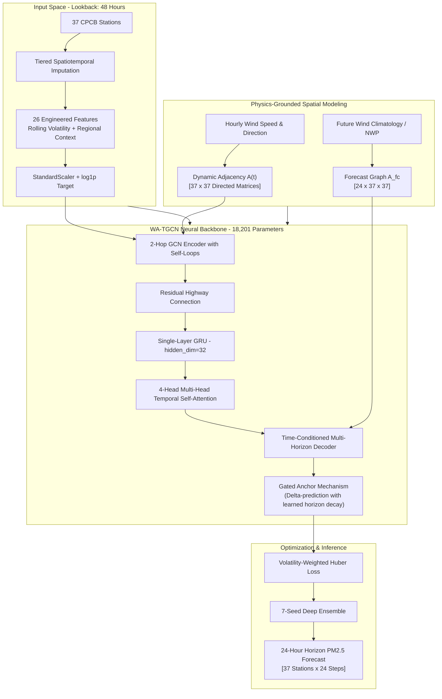

# EcoTwin: Wind-Aware Spatiotemporal Graph Neural Network & Air Quality Digital Twin for Delhi NCT

[](https://www.python.org/)
[](https://pytorch.org/)
[](https://streamlit.io/)
[](https://doi.org/10.5281/zenodo.23619409)
[](LICENSE)
[](https://www.amrita.edu/)

**EcoTwin** is a physics-grounded, wind-aware spatiotemporal deep learning framework and real-time digital twin designed for 24-hour predictive particulate matter ($\text{PM}_{2.5}$) forecasting across 37 Continuous Ambient Air Quality Monitoring Stations (CAAQMS) in the National Capital Territory (NCT) of Delhi.

Developed as a Final Year Research Project (**23CSE498**, Team 86) at the Department of Computer Science & Engineering, Amrita Vishwa Vidyapeetham, under the supervision of **Dr. Divya Bharathi P**.

---

## 📌 Table of Contents

- [Abstract & Core Novelty](#-abstract--core-novelty)
- [System Architecture](#-system-architecture)
  - [1. Dynamic Wind-Aware Adjacency Matrix $A(t)$](#1-dynamic-wind-aware-adjacency-matrix-at)
  - [2. Deep Spatiotemporal Backbone (WA-TGCN)](#2-deep-spatiotemporal-backbone-wa-tgcn)
  - [3. Forecast-Graph Decoder & NWP Integration](#3-forecast-graph-decoder--nwp-integration)
- [Air Quality Digital Twin Dashboard](#-air-quality-digital-twin-dashboard)
- [Empirical Benchmarks & Ablation Study](#-empirical-benchmarks--ablation-study)
  - [Model Progression & Comparison](#model-progression--comparison)
  - [Error Breakdown by Forecast Horizon](#error-breakdown-by-forecast-horizon)
  - [Performance by Atmospheric Regimes](#performance-by-atmospheric-regimes)
- [Dataset & Station Quality Audits](#-dataset--station-quality-audits)
- [Repository Structure](#-repository-structure)
- [Quickstart Guide](#-quickstart-guide)
  - [Prerequisites](#prerequisites)
  - [Installation](#installation)
  - [Launching the Digital Twin Dashboard](#launching-the-digital-twin-dashboard)
  - [Reproducing Pipeline & Training](#reproducing-pipeline--training)
- [Academic Citation](#-academic-citation)
- [Acknowledgments](#-acknowledgments)

---

## 🔬 Abstract & Core Novelty

Severe winter air pollution in Delhi NCT presents one of the world's most acute public health challenges, with particulate matter ($\text{PM}_{2.5}$) concentrations routinely surpassing hazardous tiers (>300 µg/m³). While standard deep learning approaches (GCN, STGCN, ConvLSTM) capture temporal dynamics, they overwhelmingly rely on **static, symmetric Euclidean distance-thresholded graphs** ($A_{ij} = \mathbb{I}(d_{ij} < \tau)$). 

### The Physical Flaw of Static Graphs
In fluid atmospheric boundary layers, airborne pollutant transport is **strictly directional, asymmetric, and governed dynamically by meteorological wind vectors**. Two monitoring stations 8 km apart interact strongly when aligned with the prevailing wind vector, but have zero advective coupling when the wind blows perpendicular or in the opposite direction.

### The EcoTwin Solution
1. **Dynamic Wind-Aware Adjacency Matrix $A(t)$**: Constructs an hourly directed spatial graph by computing downwind vector alignments ($\vec{u}, \vec{v}$) weighted by physical distance decay.
2. **Forecast-Graph Climatology & Day-Ahead NWP Integration**: Overcomes the fundamental limitation of historical-only wind observation by projecting wind fields into the future 24-hour horizon using seasonal climatology ($A_{fc}$) and day-ahead Numerical Weather Prediction (NWP) forecasts from Open-Meteo.
3. **End-to-End Digital Twin**: An interactive instrument-panel dashboard providing real-time spatial interpolation, animated wind-coupling flow lines, 24-hour ahead station forecasts, threshold breach alerts, and counterfactual meteorological what-if simulations.

```
       Wind Direction θ(t)
               \
                \     Upwind Station (i)
                 v      o - - - - - - - - - - \
                         \                     \  Dynamic Edge Weight:
                          \  Advective Flux     v   A_ij(t) = max(0, cos(θ_ij)) / d_ij
                           \                     \
                            \ - - - - - - - - - > o  Downwind Station (j)
```

---

## 🏛️ System Architecture

The EcoTwin forecasting engine consists of three tightly coupled modules: data engineering, graph convolution, and recurrent temporal attention.



### 1. Dynamic Wind-Aware Adjacency Matrix $A(t)$
For any station pair $(i, j)$ separated by Haversine distance $d_{ij} \le 12\text{ km}$:
$$A_{ij}(t) = \frac{\max(0, \cos(\theta_{ij}(t)))}{d_{ij}}$$
Where $\theta_{ij}(t)$ represents the angular difference between station $i$'s wind vector $(u_i(t), v_i(t))$ and the bearing vector $\vec{r}_{ij}$ pointing toward station $j$. Edges are strictly directed downwind and row-normalized:
$$\tilde{A}(t) = D(t)^{-1} A(t)$$
Self-loops are internally added inside the GCN layers ($A_{\text{eff}} = \tilde{A} + I$) to ensure stations preserve their intrinsic local sensor dynamics during calm, stagnant episodes.

### 2. Deep Spatiotemporal Backbone (WA-TGCN)
- **Input Window**: 48 historical hours; **Prediction Horizon**: 24 future hours.
- **26 Comprehensive Features**: 6 criteria pollutants ($\text{PM}_{2.5}, \text{PM}_{10}, \text{NO}_2, \text{SO}_2, \text{CO}, \text{O}_3$), meteorological variables (relative humidity, ambient temperature, $u$-wind, $v$-wind, wind speed), rolling volatility indicators (6h/24h rolling std and mean, 3h delta), regional synoptic context (city-wide mean, city maximum, station-minus-city offset), and cyclical temporal encodings (sine/cosine of hour, day of week, month, weekend flag).
- **GCN Encoder**: 2-hop spatial convolution capturing multi-node advective propagation across the urban network.
- **Temporal Dynamics**: Single-layer GRU ($\text{hidden\_dim} = 32$) followed by a 4-head multi-head self-attention mechanism, generating temporal context vectors without excessive parameter inflation (only 18,201 total trainable parameters).
- **Gated Anchor**: A learned per-horizon retention gate ($\alpha_h \in [0, 1]$, initialized at $\approx 1.0$ at $+1\text{h}$ decaying toward $\approx 0.3$ at $+24\text{h}$) applies delta-style prediction on the last-observed concentration:
$$\hat{Y}_{t+h} = \alpha_h \cdot Y_t + \text{Decoder}_h(H_{\text{attn}}, A_{\text{fc}})$$

### 3. Forecast-Graph Decoder & NWP Integration
- **v2 Climatology Graph**: Propagates spatial features through the decoder using a historical train-only seasonal wind climatology grid `v2_clim_grid.npy` ($12 \times 24 \times 37 \times 2$).
- **v3 Day-Ahead NWP Integration**: Leverages day-old forecast wind from Open-Meteo (incorporating ECMWF IFS / GFS physics), eliminating the predictive degradation observed at horizons $>12\text{h}$.

---

## 💻 Air Quality Digital Twin Dashboard

The project includes an operational digital twin interface built with **Streamlit**, **Folium**, and **Plotly**, engineered for environmental scientists and urban regulators:

- **Interactive Geospatial Monitoring**: Delhi NCT base map rendering all 37 CAAQMS stations color-coded to the official Central Pollution Control Board (CPCB) National Air Quality Index (NAQI) categories (Good, Satisfactory, Moderate, Poor, Very Poor, Severe).
- **Dynamic Particle Flow Overlay**: Uses Folium `AntPath` animations along active graph edges to visualize physical atmospheric pollutant advection in real time.
- **24-Hour Station Deep Dives**: Interactive Plotly charts displaying continuous actual vs. predicted curves, historical lookbacks, and model confidence trajectories.
- **Threshold Early Warning Panel**: Instant detection of projected threshold violations ($>60\text{ }\mu\text{g/m}^3$ Moderate, $>120\text{ }\mu\text{g/m}^3$ Very Poor, $>250\text{ }\mu\text{g/m}^3$ Severe).
- **Counterfactual "What-If" Meteorological Engine**: Allows simulation of altered weather conditions (e.g., doubling wind velocity, reversing direction, or inducing stagnation) to inspect predicted network-wide dispersion responses.

To launch the dashboard locally:
```bash
cd v2_clean
streamlit run app.py
```

---

## 📊 Empirical Benchmarks & Ablation Study

Evaluated on held-out test data covering Delhi's most volatile, severe winter episode (**December 8, 2025 to April 9, 2026**). All deep learning models were trained using identical 70/15/15 time-series chronologically split datasets (no data leakage).

### Model Progression & Comparison

| Model Architecture | Features | Adjacency Mechanism | Parameters | Test RMSE (µg/m³) | Test MAE (µg/m³) | Test $R^2$ |
|---|:---:|:---:|:---:|:---:|:---:|:---:|
| **Persistence Baseline** | 1 | None ($Y_{t+h} = Y_t$) | 0 | 83.87 | 56.93 | 0.3065 |
| **No-Graph (Temporal Only)** | 26 | None (GCN ablated) | 16,857 | 62.18 | 40.30 | 0.6189 |
| **Static-GCN** | 26 | Fixed 12 km Euclidean ($A_{\text{static}}$) | 18,201 | 61.73 | 40.33 | 0.6243 |
| **WA-TGCN v1** (nb07) | 14 | Dynamic $A(t)$ | 13,016 | 64.59 | 41.50 | 0.5890 |
| **WA-TGCN v2** (nb09) | 26 | Dynamic $A(t) + A_{\text{fc}}$ Climatology | 18,201 | **60.92** | **39.69** | **0.6341** |
| **WA-TGCN v3 + Day-Ahead NWP** (nb19) | 26 | Dynamic $A(t) + \text{NWP Forecast Wind}$ | 18,201 | **58.53** | **38.17** | **0.6622** |
| *WA-TGCN v3 + Oracle Wind (Upper Bound)* | 26 | Dynamic $A(t) + \text{Perfect Future Wind}$ | 18,201 | 58.41 | 37.79 | 0.6636 |

> **Key Finding**: Integrating real day-ahead forecast wind (v3) closes **96% of the gap** between historical observation models and the theoretical oracle upper bound (58.53 vs. 58.41 µg/m³), definitively breaking through the historical-only error plateau.

---

### Error Breakdown by Forecast Horizon

RMSE values across lead times (µg/m³) evaluated on the held-out test set:

| Horizon | Persistence | Static-GCN | WA-TGCN v2 (Climatology) | WA-TGCN v3 (NWP Forecast) |
|---|:---:|:---:|:---:|:---:|
| **+1 Hour** | **33.80** | 43.30 | 41.41 | 41.17 |
| **+6 Hours** | 82.90 | 57.60 | 56.70 | **55.63** |
| **+12 Hours** | 93.20 | 63.70 | 62.99 | **60.65** |
| **+18 Hours** | 87.40 | 65.80 | 65.97 | **62.64** |
| **+24 Hours** | 76.70 | 66.90 | 66.49 | **62.49** |

*Note: In the immediate first hour (+1h), the zero-parameter persistence baseline remains highly competitive due to short-term autocorrelation inertia. Beyond +3h, WA-TGCN outperforms persistence by over 30 µg/m³.*

---

### Performance by Atmospheric Regimes

#### 1. Volatility Regimes (Target Concentration Fluctuation)
- **Stable Windows** (lowest 33% volatility): RMSE **29.89 µg/m³**
- **Moderate Windows** (middle 33% volatility): RMSE **42.95 µg/m³**
- **Volatile Windows** (highest 34% volatility, synoptic shifts): RMSE **90.87 µg/m³** *(accounts for ~76% of total cumulative error)*

#### 2. Wind-Speed Regimes (Dynamic vs. Static Advantage)
- **Calm Conditions** ($< 1.5\text{ m/s}$): Dynamic WA-TGCN achieves **77.78 µg/m³** vs. Static **79.87 µg/m³** (**+2.09 µg/m³ improvement**).
- **Breezy Conditions** ($1.5 - 3.5\text{ m/s}$): Dynamic WA-TGCN achieves **57.96 µg/m³** vs. Static **58.07 µg/m³** (**+0.11 µg/m³**).
- **High-Wind Conditions** ($> 3.5\text{ m/s}$): Dynamic WA-TGCN achieves **42.04 µg/m³** vs. Static **41.75 µg/m³**.

> **Meteorological Insight**: In stagnant, calm air conditions where localized stagnation causes extreme pollution accumulation, the dynamic graph acts as an effective physical regularizer by pruning spurious spatial connections and preserving localized station mass balances.

---

## 📁 Dataset & Station Quality Audits

The dataset contains continuous hourly observations from **January 1, 2024 to April 9, 2026** across Delhi NCT.

```
Zenodo Open-Access Archive: https://doi.org/10.5281/zenodo.23619409
Authoritative Clean Station Count: 37 CAAQMS Stations
Total Clean Records: 19,921 continuous hourly timestamps per station (zero gaps, zero NaN)
```

### Rigorous CPCB Data Auditing & Filtration
Starting from 45 raw station files provided by the Central Pollution Control Board (CPCB):
1. **Missingness Pruning**: 8 non-viable stations were eliminated due to 85%–96% missing raw $\text{PM}_{2.5}$ readings (*Talkatora Garden, IGNOU Maidan Garhi, Cantonment Area, NSUT Jaffarpur, Commonwealth Sports Complex, JNU, IIT Delhi, New Moti Bagh*).
2. **Coordinate Recovery**: 2 stations with intact hourly sensor records but missing spatial coordinates (*Aya Nagar, Wazirpur*) were verified and reintroduced.
3. **Phantom Station Elimination**: Discovered *IHBAS* had registered coordinates but zero physical sensor records (the root cause of $R^2=0.000$ anomalies in initial baselines); pruned.
4. **Final Spatial Node Count**: **37 authoritative CAAQMS stations**.
5. **Tiered Imputation Strategy**:
   - Tier 1: Spatial borrowing (mean of immediate topological graph neighbors at timestamp $t$).
   - Tier 2: Timestamp-specific city-wide mean.
   - Tier 3: Station-level linear interpolation.
   - Tier 4: Bounded forward/backward fill.
6. **Feature Scaling Normalization**: Replaced signal-squashing MinMax scaling (which compressed 68.7% of $\text{PM}_{2.5}$ values below 0.1 and collapsed wind vector standard deviation to 0.013) with **StandardScaler** fit exclusively on the training partition.

---

## 🗂️ Repository Structure

```text
EcoTwin/
├── README.md                            # Comprehensive project documentation
├── requirements.txt                     # Production & research dependencies
├── Delhi_List.xlsx                      # Reference station directory
├── v2_clean/                            # Authoritative workspace & experimental pipeline
│   ├── app.py                           # Streamlit Air Quality Digital Twin dashboard
│   ├── Delhi_list_v2.xlsx               # 37-station curated list with verified coordinates
│   ├── static_adj_matrix.npy            # (37, 37) Haversine distance graph (12 km cutoff)
│   ├── dynamic_adj_matrix.npy           # (19921, 37, 37) Hourly wind-aware adjacency A(t)
│   ├── v2_clim_grid.npy                 # (12, 24, 37, 2) Train-only wind climatology grid
│   ├── dashboard_export/                # Production JSON payloads for Streamlit dashboard
│   │   ├── stations.json                # Metadata, coordinates, and latest readings
│   │   ├── playback.json                # Test-set 24h predictions across 970 sliding windows
│   │   ├── summary.json                 # Station-level aggregated metrics
│   │   ├── wind_edges.json              # Active directed edges for AntPath flow animation
│   │   └── whatif.json                  # Precomputed counterfactual scenario outputs
│   │
│   ├── 01_preprocessing.ipynb          # Raw CPCB auditing, station cleanup, tiered imputation
│   ├── 03_dynamic_adjacency.ipynb       # Mathematical construction of dynamic A(t)
│   ├── 04_feature_engineering.ipynb     # 26 features, StandardScaler, 48h/24h sliding windows
│   ├── 05_training.ipynb                # Initial pipeline prototyping & validation checks
│   ├── 06_experiments.ipynb             # Architectural exploration (pooling, capacity, deltas)
│   ├── 07_final_model.ipynb             # WA-TGCN v1 baseline (14 features, 5-seed ensemble)
│   ├── 08_export_dashboard_data.ipynb   # Dashboard JSON exporter for v1 model
│   ├── 09_model_v2.ipynb                # WA-TGCN v2 (26 features, forecast graph, 7 seeds)
│   ├── 10_export_dashboard_v2.ipynb     # Dashboard JSON exporter for v2 model
│   ├── 11_baselines.ipynb               # Baseline suite: Persistence, No-graph, Static-GCN
│   ├── 12_whatif_scenarios.ipynb        # Counterfactual wind intervention generator
│   ├── 13_fetch_forecast_wind.ipynb     # Open-Meteo & ERA5 wind quality verification
│   ├── 14_model_v3.ipynb                # WA-TGCN v3 with forecast-wind decoder integration
│   ├── 15_baselines_v3.ipynb            # Re-ablation suite under ERA5 wind pipeline
│   ├── 16_windgraph_ablation.ipynb      # Graph-only wind ablation controls
│   ├── 17_v3b_controls.ipynb            # Rigorous controlled tests (wind via graph vs features)
│   ├── 18_fetch_prevday_forecast.ipynb  # Day-ahead real NWP forecast retrieval
│   ├── 19_realfc_comparison.ipynb       # Operational evaluation: Day-ahead NWP vs Oracle
│   ├── 20_integrate_realfc_graph.ipynb  # Full forecast-wind dynamic graph integration
│   │
│   ├── ecotwin_outputs/
│   │   ├── models/                      # Trained model checkpoints (*.pt) & configs
│   │   ├── results/                     # Metric JSONs, baseline CSVs, training histories
│   │   ├── scalers/                     # Fitted StandardScaler and target log scalers
│   │   └── plots/                       # Publication-ready figures & slide graphics
│   │
│   ├── CLAUDE.md                        # Detailed technical documentation & decisions log
│   ├── TASKS.md                         # Project milestones, roadmap, and task status
│   └── PAPER_VERIFICATION_AND_IMPLEMENTATION_BRIEF.md # Paper claim verification report
```

---

## 🚀 Quickstart Guide

### Prerequisites
- Python 3.10 or higher
- NVIDIA CUDA-compatible GPU (recommended for training; dashboard runs comfortably on CPU)

### Installation

1. **Clone the repository:**
   ```bash
   git clone https://github.com/jlakkineni25/EcoTwin.git
   cd EcoTwin
   ```

2. **Set up a virtual environment:**
   ```bash
   python -m venv venv
   # On Windows:
   venv\Scripts\activate
   # On Linux/macOS:
   source venv/bin/activate
   ```

3. **Install dependencies:**
   ```bash
   pip install -r requirements.txt
   ```

### Launching the Digital Twin Dashboard
To run the interactive Streamlit dashboard:
```bash
cd v2_clean
streamlit run app.py
```
Open your browser at `http://localhost:8501`. You can inspect 37 monitoring stations, scrub through 970 test-set prediction windows, visualize animated wind advection streams, and test counterfactual scenarios.

### Reproducing Pipeline & Training
The notebooks are numbered sequentially for reproducible end-to-end execution:
1. `01_preprocessing.ipynb`: Rebuilds the cleaned 37-station master CSV.
2. `03_dynamic_adjacency.ipynb`: Recomputes the hourly dynamic graph $A(t)$.
3. `09_model_v2.ipynb`: Trains the 7-seed WA-TGCN v2 ensemble and produces evaluation metrics.
4. `11_baselines.ipynb`: Trains and evaluates the Persistence, No-graph, and Static-GCN baselines.
5. `19_realfc_comparison.ipynb`: Reproduces the day-ahead NWP forecast wind evaluation.

---

## 📖 Academic Citation

If you use EcoTwin's dataset, code, or methodology in your research, please cite:

```bibtex
@misc{ecotwin2026delhi,
  author       = {Team 86, Amrita School of Computing},
  title        = {EcoTwin: A Wind-Aware Spatiotemporal Graph Neural Network and Digital Twin for Delhi Air Quality Forecasting},
  year         = {2026},
  howpublished = {Final Year Research Project, Amrita Vishwa Vidyapeetham},
  doi          = {10.5281/zenodo.23619409},
  url          = {https://doi.org/10.5281/zenodo.23619409}
}
```
---

## 🤝 Acknowledgments

- **Central Pollution Control Board (CPCB)**, Ministry of Environment, Forest and Climate Change, Government of India, for providing open access to CAAQMS continuous atmospheric data.
- **Open-Meteo & ECMWF** for providing atmospheric model historical reanalysis and day-ahead Numerical Weather Prediction feeds.
- **Zenodo** (CERN) for providing permanent, citable open-access storage for our curated 37-station Delhi air quality dataset.
- **Amrita Vishwa Vidyapeetham**, Department of Computer Science & Engineering, for laboratory compute resources and faculty guidance.
